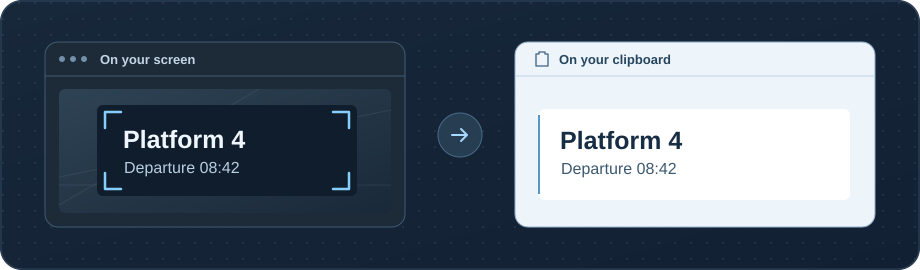

<div align="center">
  
  <h1>TextLens</h1>
  <p><strong>Copy the text you see on your Mac.</strong></p>
  <p>Fast, offline OCR for screenshots, scanned PDFs, and paused video.</p>
  <p><a href="#install"><strong>Install with Homebrew</strong></a> · <a href="https://github.com/MRZ07/TextLens/releases/latest">Download for Mac</a></p>
  <p>macOS 14 Sonoma or later · Apple silicon · Signed and notarized releases</p>
</div>



## A speed-focused TRex alternative

TextLens is built for the screen-to-clipboard workflow. Use either of two global shortcuts to keep the original line breaks or paste everything as one line. Recognition runs locally with Apple Vision, and you can search and recopy recent captures from the menu bar.

Accurate mode handles small or stylized text and retries weak results with enhanced contrast. Fast mode tries a quicker pass for clear text in supported languages and switches to Accurate when the result is uncertain. Start with your system language, choose a specific language, or enable automatic detection for mixed-language images.

## Install

```sh
brew tap MRZ07/textlens https://github.com/MRZ07/TextLens
brew trust --cask MRZ07/textlens/textlens
brew install --cask MRZ07/textlens/textlens
```

For a direct install, download the signed ZIP, unzip it, and drag **TextLens.app** to **Applications**. [Download the latest release](https://github.com/MRZ07/TextLens/releases/latest).

## Capture, then paste

| What you want to do | Where to start |
| --- | --- |
| Capture a region and keep its line breaks | <kbd>⌘</kbd><kbd>⌥</kbd><kbd>⇧</kbd><kbd>T</kbd> |
| Capture a region as one line | <kbd>⌘</kbd><kbd>⌥</kbd><kbd>⇧</kbd><kbd>L</kbd> |
| Extract text from a saved screenshot or photo | Menu bar → **Read Text from Image…** |
| Find and copy text from an earlier capture | Menu bar → **Capture History…** |

For a screen capture, drag around the text, then paste it with <kbd>⌘</kbd><kbd>V</kbd>. You can change either shortcut in **Settings → Shortcuts**. If automatic copying is off, use **Copy Text** in Capture History.

## Privacy and settings

- **On-device recognition.** Images stay on your Mac. TextLens saves the newest 100 text captures and discards the temporary screenshots. Clear saved text under **Settings → History**.
- **Screen recording access.** Open TextLens to see your access status under **Settings → General**. Use **Open System Settings…** to manage access, then reopen TextLens if macOS asks. You can read saved images without granting screen recording access.
- **Notifications and startup.** Control text previews, sound, and launch at login under **Settings → General**. macOS notification settings and Focus can suppress banners or sound. Text previews can appear on the Lock Screen.
- **Recognition and clipboard.** Set the text language, mode, optional spelling correction, and automatic copying under **Settings → Capture**.

## Update or build from source

Homebrew updates run when you ask for them.

```sh
brew update
brew upgrade --cask MRZ07/textlens/textlens
```

To test and build a local app with Xcode and Swift:

```sh
swift test
./scripts/build-app.sh
open dist/TextLens.app
```

## Publish a release

Use `scripts/publish.sh` for every release. Set the next version in [VERSION](VERSION) and commit it with the app changes on `main`. Use a Mac with Xcode, a **Developer ID Application** identity, the `TextLensNotary` keychain profile, and an authenticated GitHub CLI with write access to this repository.

```sh
./scripts/publish.sh /path/to/release-notes.md
```

Omit the notes path to use GitHub-generated notes. The script runs the test suite, signs and notarizes the app, sets the Homebrew cask version and SHA-256, and creates a tagged GitHub release. It verifies the public ZIP before pushing the cask to `main`. If interrupted, rerun the same command from the same checkout.

After publishing, run the Homebrew update commands above to verify the upgrade on a Mac with the previous version installed.

## Credits

TextLens was inspired by TRex and is independently developed. [TRex by amebalabs](https://github.com/amebalabs/TRex). Global shortcuts use [KeyboardShortcuts](https://github.com/sindresorhus/KeyboardShortcuts).

There is currently no license file. Public visibility does not grant permission to reuse or redistribute the code or icon.
