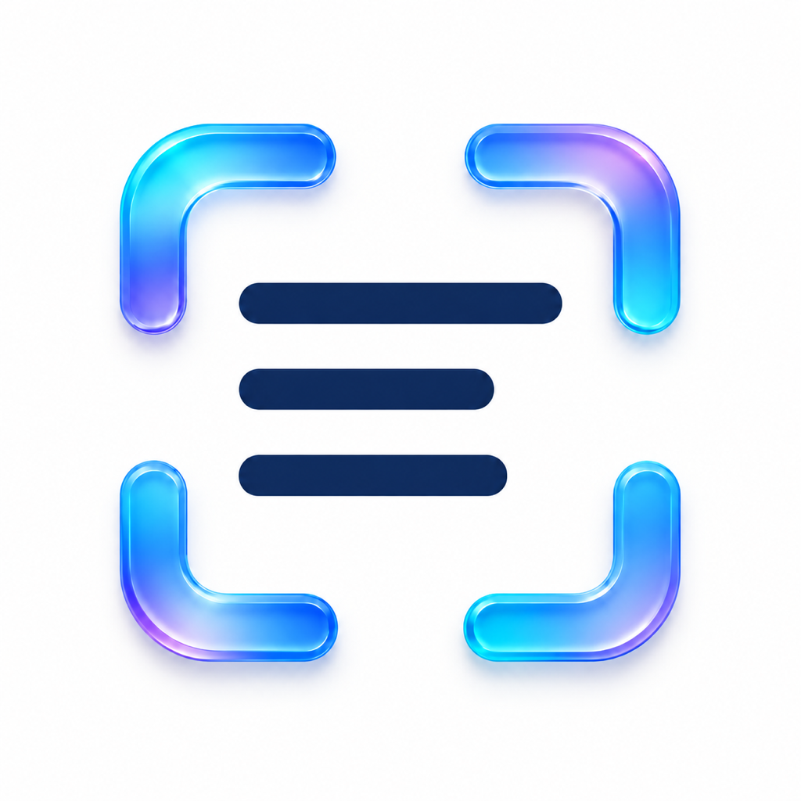

# TextLens

**Offline macOS OCR for copying text from your screen**

TextLens is a menu bar app for screen text recognition on macOS. Select a region, let Apple Vision recognize the text on your Mac, then paste it into any app. Screenshots are processed locally; nothing is uploaded for OCR.

**macOS 14 Sonoma or later · Apple Silicon · Signed and notarized release**

## Install with Homebrew

Homebrew is the recommended way to install TextLens:

```sh
brew tap MRZ07/textlens https://github.com/MRZ07/TextLens
brew trust --cask MRZ07/textlens/textlens
brew install --cask MRZ07/textlens/textlens
```

Homebrew manages the installation, but it does not install app updates in the background. Update TextLens when you choose:

```sh
brew upgrade --cask MRZ07/textlens/textlens
```

This upgrades only TextLens. New releases need a higher version number. If a release is replaced with the same version, run `brew reinstall --cask MRZ07/textlens/textlens` instead.

### Direct download

Prefer not to use Homebrew? **[Download the signed and notarized TextLens ZIP](https://github.com/MRZ07/TextLens/releases/download/v0.1.0/TextLens-0.1.0.zip)**, unzip it, drag **TextLens.app** into **Applications**, and launch it. Browse all versions on the [Releases page](https://github.com/MRZ07/TextLens/releases).

## Copy text from your screen

1. Click the menu bar icon and choose **Capture text**, or press **⌘⌥⇧T**.
2. Drag over the text you want to recognize.
3. Paste—the recognized text is copied automatically.

Normal capture preserves line breaks. Choose **Capture text without line breaks**, or press **⌘⌥⇧L**, to join the recognized lines into one line. Change or clear each shortcut independently in **Settings → Shortcuts**; the current shortcuts appear beside their menu commands.

The menu also opens searchable **Capture History**, **Settings**, and **About TextLens**. Closing those windows leaves TextLens running; choose **Quit TextLens** to exit.

## Features

- On-device OCR with Apple Vision—no upload required for recognition.
- Select a screen region and copy recognized text to the clipboard.
- Two customizable global shortcuts, with or without line breaks.
- Search and copy again from the newest 100 captures.
- Optional automatic clipboard copying, success notifications, and notification sound; these are enabled by default.
- Opt-in start at login, with controls in Settings.
- History and privacy controls, plus a link to macOS screen-recording settings.

## Privacy, permissions, and OCR limits

If macOS blocks a capture, allow TextLens in **System Settings → Privacy & Security → Screen & System Audio Recording**. Screenshots are temporary; only recognized text is saved in `~/Library/Application Support/TextLens/capture-history.json`. Clear saved text in Settings or Capture History.

**Clipboard and notifications:** automatic clipboard copying, success notifications, and notification sound are enabled by default and can be changed in **Settings → General**. With automatic copying off, use the Copy button in Capture History. Notifications include a preview of recognized text and may appear on the lock screen. macOS notification permission is required; Focus and system notification settings may suppress banners or sound. Turning notifications off also prevents their sound.

**Start at login:** TextLens asks once whether it should start when you log in; it is not enabled before you agree. Change this in **Settings → General → Startup**. If macOS requires approval, TextLens links to Login Items settings and shows the pending status instead of claiming startup is active.

**OCR limits:** TextLens uses Vision's accurate mode and language correction, but this version has no language picker or explicit language configuration. Recognition is biased toward English; other languages, small fonts, and handwriting may be less reliable.

## Build and release from source

Install Xcode Command Line Tools with Swift. Release builds are tested with Xcode 27.2.

```sh
swift test
./scripts/build-app.sh
open dist/TextLens.app
```

The local build is unsigned and includes the icon and SwiftPM resource bundles. To create a signed, notarized ZIP release, install a **Developer ID Application** identity and configure the `TextLensNotary` keychain profile, then run:

```sh
./scripts/package-release.sh
```

Set `TEXTLENS_VERSION` to use a different version. The script prints the ZIP's SHA-256; update the Cask to match the published download. TextLens does not install a background updater; use `brew upgrade --cask MRZ07/textlens/textlens` to upgrade a Homebrew installation.

## Credits and license

Inspired by [TRex](https://github.com/amebalabs/TRex); independently implemented and not affiliated with its authors. Global shortcuts use [KeyboardShortcuts](https://github.com/sindresorhus/KeyboardShortcuts).

There is currently no license file. Public visibility does not grant permission to reuse or redistribute the code or icon.
